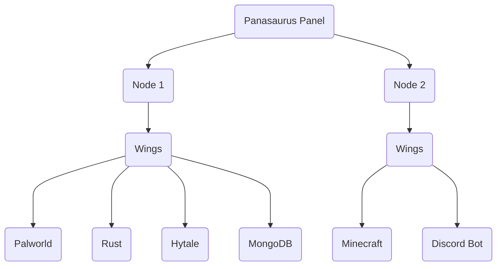

import Admonition from '@theme/Admonition';

# Welcome to Panasaurus!

### What is [Pelican](https://github.com/panasaurus/panel)?

**Panasaurus** is a free, open-source server management panel for hosting game servers, software and applications in isolated Docker containers.

The Panel is the web interface: it shows information about your servers and sends commands to them.

### What is [Wings](https://github.com/panasaurus/wings)?

**Wings** is the subsystem that runs on each machine hosting your servers.
It handles the Docker containers behind the scenes (creating, starting, hibernation, stopping and restarting them) on behalf of the Panel. Users never interact with Wings directly.

### Example Setup

### Open Source!

The Panel is released under [Apache License 2](https://www.apache.org/licenses/LICENSE-2.0) and Wings under [MIT](https://opensource.org/license/mit).
Anyone can browse the code, contribute improvements, and help identify bugs and security issues on [GitHub](https://github.com/panasaurus).

<Admonition type="warning" title="Reporting Security Issues">
    If you notice anything that raises a concern, please reach out directly to **team@panasaurus.com**  or at **aarvsn@disroot.org**
    For security reasons, we ask that you handle security disclosures responsibly and **avoid posting them on GitHub.**
</Admonition>